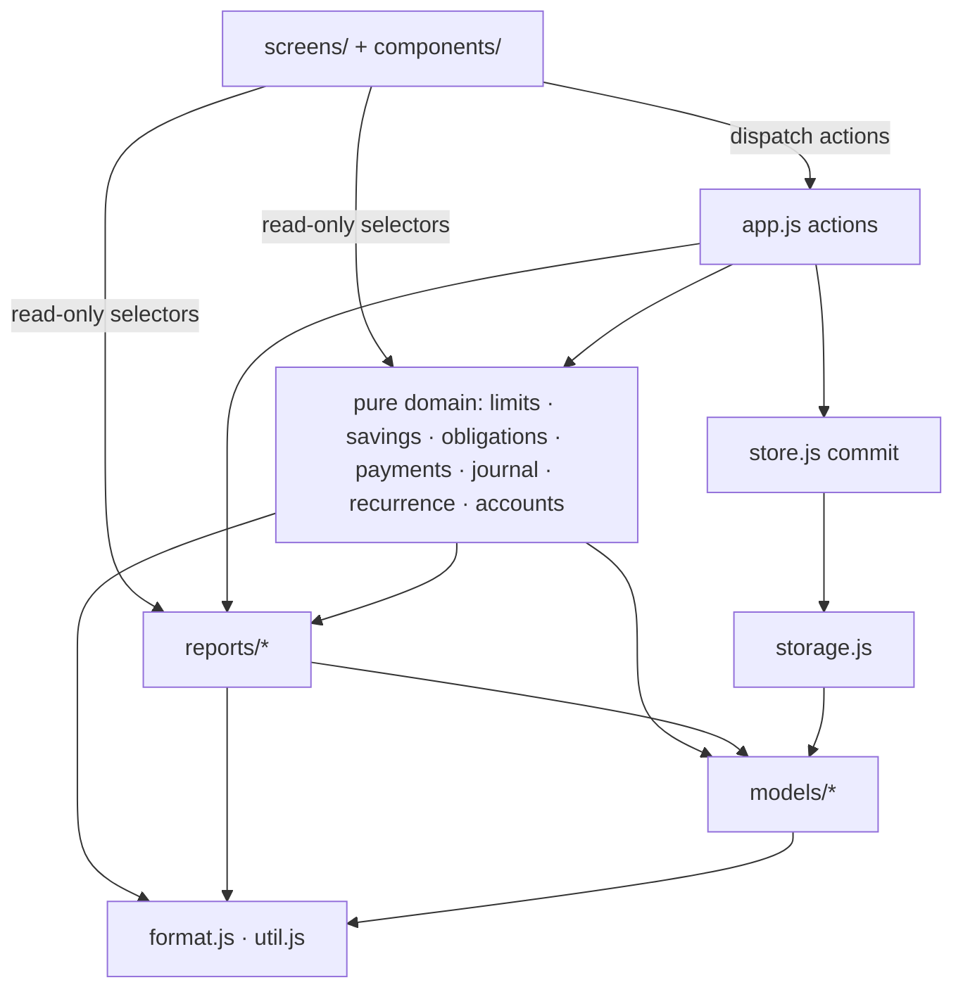
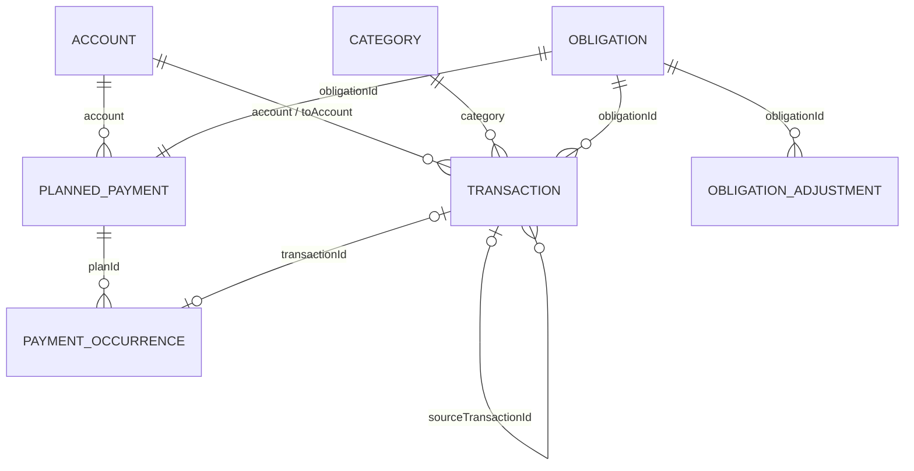
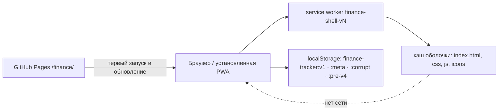

# Architecture Spine — Финансы, первая версия

## Design Paradigm

Слоистая vanilla-архитектура: статическая разметка в `index.html`, экраны и компоненты наполняют DOM, единственный writes-путь — `app.actions` → `store.commit`, решения о деньгах и датах живут в чистых модулях без DOM и localStorage.



## Invariants & Rules

### AD-1 — Слои и направление зависимостей

- **Binds:** все модули `js/`
- **Prevents:** циклы `format ↔ recurrence`; финансовые формулы расходятся между экранами; ложные нарушения слоёв на существующем коде; `limits.js` не может взять примитив баланса.
- **Rule:** зависимости только вниз: `screens/components → app.actions → pure domain / reports → models → format/util`. Экраны и компоненты читают чистые селекторы напрямую, меняют состояние — только через `app.actions`. `app.js` — единственный composition root: он импортирует `store`, `storage` и создаёт экраны; больше никто не импортирует `store`/`storage`. `storage.js` может импортировать `schema.js`, `models`, `seed`, `format`. Чистые модули могут использовать примитивы `reports/balanceSheet.js` и `categoryName` из `reports/incomeStatement.js`; отчёты могут импортировать отчёты; отчёты **не** импортируют домен. `format.js` владеет `clampDay`/`daysInMonth`/`addMonthsClamped` и не импортирует `recurrence.js`; `recurrence.js` импортирует `format.js`. Циклов нет.

### AD-2 — Единственный путь изменения состояния

- **Binds:** все действия, импорт, сброс, восстановление, синхронизация вкладок
- **Prevents:** экран мутирует `state`; производные значения сохраняются и устаревают; частично применённое действие; вторая вкладка молча перезаписывает первую; `{ok:false}` читается как успех; импорт публикуется до сохранения.
- **Rule:** состояние меняется только через `store.commit(mutator)`; одно действие — одна атомарная мутация. `commit` клонирует draft, ловит доменные исключения (`reason: 'invalid'`), сверяет сохранённый `rev` с базовым (`reason: 'stale'`), сохраняет (`reason: 'quota'`), затем публикует и увеличивает `rev`. Возврат — только `{ ok: true } | { ok: false, reason: 'invalid' | 'stale' | 'quota' | 'forward' }`; все существующие вызовы `if (!saved)` переводятся на `result.ok` в той же правке, truthiness-проверок объекта нет. `replace(next, { persist })` сохраняет **первым**, возвращает тот же результат и публикует только при успехе; при ошибке старое состояние остаётся. `replace` разрешён для импорта, сброса, восстановления pre-v4 и storage-события; в safe mode — только для подтверждённого восстановления. `store.replace` из storage-события обновляет базовый `rev`. Производные величины считаются на чтении и в `state` не хранятся.

### AD-3 — Деньги и ставки

- **Binds:** все денежные поля, парсеры, округление, отчёты
- **Prevents:** float в состоянии; рубли и копейки в одном поле; `parseAmount()` для процентов; нулевой `openingBalance` отвергается; отрицательное тело не проходит валидатор; `parseRateBp` округляет вместо отказа.
- **Rule:** деньги — `Number.isSafeInteger` в копейках; ставки — целые базисные пункты (`1 bp = 0,01 п.п.`, `100% = 10000`). `parseAmount()` — только деньги, `parseRateBp()` — только ставки; `parseRateBp` принимает до двух знаков после запятой и **отвергает** более точные значения, без округления. Валидаторы: `isSafeMinor` (> 0) — `amount`, `contractPayment`; `isNonNegativeMinor` (≥ 0) — `openingBalance`, `interest`, `savingsRateBp`/`annualRateBp` (плюс верхняя граница 10000); `isSafeMinorSigned` (может быть 0) — `principal`; `delta` — знаковый и ≠ 0. Проценты по долгу: `floor(remaining × annualRateBp / 120000)`; норма сбережений: `floor(income × savingsRateBp / 10000)`; остаток от округления остаётся на счёте-источнике. В формулах запрещены `toFixed`, `parseFloat` и арифметика с рублями.

### AD-4 — Даты, «сегодня» и якорь серии

- **Binds:** `format.js`, `recurrence.js`, все функции с датами, лимит, прогноз
- **Prevents:** UTC-сдвиг; `31 января + 1 месяц = 3 марта`; якорь 31-го теряется после февраля; тесты зависят от системных часов; `rangeFor` принимает `Date`.
- **Rule:** даты — строки `YYYY-MM-DD`, сравнение лексикографическое; арифметика только через `parseISO()`, `toISO()`, `addDaysISO()`, `addMonthsClamped()`. `clampDay()`/`daysInMonth()` живут в `format.js`; `addMonthsClamped()` использует их; `recurrence.js` импортирует их и не дублирует. `rangeFor(kind, todayISO)` принимает ISO, не `Date`; `monthRange()` и экраны отчётов передают ISO. Чистые функции требуют `today` параметром; дефолта `todayISO()` в чистых модулях нет — его подставляет composition root один раз на рендер. У серии есть `anchorDay` 1..31: `startDate` — первое отображаемое вхождение (может быть кламплено), `anchorDay` — настоящий день повторения; recurrence использует `anchorDay`.

### AD-5 — Схема v4, миграция и safe mode

- **Binds:** `schema.js`, `storage.js`, `seed.js`, `app.js` bootstrap, `screens/safeMode.js`, импорт/экспорт, service worker
- **Prevents:** старый v3-shell засевает seed поверх данных v4; миграция теряет поля; safe mode превращается в ловушку без восстановления; `loadState()` сеет при corrupt; два commit в одну миллисекунду не ловятся stale-guard.
- **Rule:** `SCHEMA_VERSION = 4`; конверт добавляет `rev: 0`, `obligations: []`, `obligationAdjustments: []`, `account.savingsRateBp: 0`, `transaction.obligationId/principal/interest: null`, `transaction.sourceTransactionId/savingsRateBp: null`, `transaction.skipSavings: null`, `category.system: false`, `category.mark: null`, `plannedPayment.obligationId: null`, `plannedPayment.archived: false`, `plannedPayment.anchorDay` (день из `startDate`), `obligation.archived: false`. `migrate()` принимает v1–v3, проставляет умолчания, сохраняет неизвестные поля сущностей и верхнеуровневые ключи; если ключ сохранить нельзя, возвращает `warnings[]`, UI показывает их. `readState()` сначала парсит, затем проверяет версию, затем мигрирует и валидирует; возвращает `{ status: 'empty' | 'ok' | 'forward' | 'corrupt', state?, warnings? }`. `forward` (версия выше текущей) определяется до миграции; `corrupt` — ошибка парсинга/валидации. `loadState()` возвращает тот же результат и сеет **только** на `empty`. Перед первой записью v4 сырой v3-конверт копируется в `finance-tracker:pre-v4`, только если копия помещается; иначе миграция прерывается с понятной ошибкой, v3 остаётся нетронутым. `pre-v4` удаляется после подтверждения пользователя в настройках (не автоматически); до подтверждения доступно «Восстановить pre-v4». `:corrupt` хранит **первую** копию и не перезаписывается. На `forward`/`corrupt` `app.js` не создаёт обычный store: рендерит `screens/safeMode.js` с действиями «экспортировать сырые данные», «импортировать проверенную копию», «восстановить pre-v4», «сбросить с подтверждением»; `commit` заблокирован, `replace` разрешён только этим действиям; обычные экраны и роутер не инициализируются, тема — системная. Storage-событие в safe mode не заменяет состояние, а показывает баннер. Выкатка v4 двухшаговая: сначала релиз с прежней схемой и forward-safe чтением (не сеять поверх непустого ключа, safe mode), проверить установку на телефоне, затем v4. Импорт всегда полностью валидируется до `replace`.

### AD-6 — Один баланс, три итога и капитал

- **Binds:** `js/reports/*`, `js/payments.js`, `js/limits.js`, `screens/dashboard.js`, `screens/reports.js`
- **Prevents:** своё определение баланса в каждом отчёте; «Остаток на конец» в ДДС не равен активам; обязательства попадают в `totalBalance()`; порядок трёх итогов плавает; архивные обязательства попадают в капитал.
- **Rule:** единственный примитив — `accountBalance(state, id, { before | asOf })`; `totalBalance()` суммирует все счета, включая архивные. `buildDashboardTotals(state)` возвращает `{ expense, savings, total }` по `account.kind` (`savings` vs остальные), архивные входят, `total = expense + savings`; порядок на экране строго «расходные → накопления → всего», суммы за всё время. «Всего на счетах» — активы, не капитал. `buildCashFlow().closing === buildBalanceSheet(asOf).totalAssets` на одну дату; `discrepancy` обязан быть `0`. Обязательства — отдельная величина, не счёт и не часть `totalBalance()`; `liabilities = Σ remainingAsOf(asOf)` по неархивным обязательствам; `equity = assets − liabilities`. Переводы не входят в P&L и итоги ДДС.

### AD-7 — Форма платежа по обязательству и measure отчётов

- **Binds:** `models/transaction.js`, `reports/incomeStatement.js`, `reports/cashFlow.js`, `reports/overview.js`, журнал
- **Prevents:** P&L считает весь платёж; ДДС считает только проценты; общая группировка молча меняет ДДС; журнал скрывает списание; снимок путают с «оценкой».
- **Rule:** платёж по обязательству — одна операция `type: 'expense'` с `obligationId`, знаковым `principal` и неотрицательным `interest`, `amount === principal + interest`; `principal` может быть отрицательным, `interest` — `0`. P&L и доходы/расходы обзора берут `interest`; ДДС и балансовый сдвиг — `amount`; журнал показывает `amount` с подстрокой «из них проценты: … (оценка)». `groupTransactionsByCategory(state, type, range, measure)` получает явный `measure: 'amount' | 'expense'`; ДДС вызывает `'amount'`, P&L — `'expense'`; вызова без `measure` нет. Снимок `principal/interest` — замороженная расчётная оценка на момент оплаты; банк главнее, поэтому в UI «оценка». Корректировки входят в P&L/обзор отдельной строкой, но не в ДДС.

### AD-8 — Остаток долга на дату

- **Binds:** `models/obligation.js`, `obligations.js`, `reports/balanceSheet.js`, `screens/reports.js`, корректировки
- **Prevents:** остаток без `asOf`; прошлый баланс меняется будущим платежом; сохранённый остаток расходится с оплатами; getter теряется после `structuredClone`; корректировка обходит P&L; экран отчёта показывает заглушку.
- **Rule:** у обязательства хранятся `loanAmount` и `initialPrincipal`; `remaining` не хранится. `remainingAsOf(state, id, asOf) = initialPrincipal − Σ principal(оплаты с этим obligationId и `date <= asOf`) + Σ delta(корректировки с `date <= asOf`)`, одна чистая функция; `remaining` = `remainingAsOf(..., today)`. `remainingAsOf` не может быть отрицательным; действие, которое это делает, отклоняется, а `validateState` проверяет это на каждой дате платежа и на сегодня. Корректировка — `obligationAdjustments` с датой не раньше последней оплаты; она меняет долг, капитал и P&L отдельной строкой «Корректировка» (плюс — расход, минус — доход), но не ДДС и не остаток на счёте; на будущие разбивки влияет, на прошлые снимки — нет. Поля остатка в формах нет. `buildBalanceSheet` отдаёт `liabilities`/`equity`; `screens/reports.js` убирает заглушку «Пока не ведутся».

### AD-9 — График обязательства, проекция и архив

- **Binds:** `models/plannedPayment.js`, `payments.js`, `recurrence.js`, `limits.js`, `obligations.js`, `app.js` plan actions, формы обязательства
- **Prevents:** второй движок дат; план остаётся разовым; якорь 31-го съезжает; архив оставляет будущие списания в резерве; правка договора ретроактивно меняет просрочку; последний платёж резервируется по полной сумме; удаление обязательства оставляет сирот.
- **Rule:** у обязательства ровно один **активный** план; обязательство — источник истины, план — проекция: `type: 'expense'`, `recurrence: 'monthly'`, `endDate: null`, `anchorDay: paymentDay`, `amount: contractPayment`, `accountId: accountId`, `categoryId: sys-interest`, `note: name`, `obligationId`, `archived`. `id`/`createdAt` плана неизменяемы; правка — in-place, не пересоздание. Счёт обязательства — только `cash | card | bank`. `plan.archived` — зеркало `obligation.archived`; `validateState` требует равенства. Архивация ставит оба флага и удаляет сохранённые вхождения с `date > today` (любой статус); вхождения с `date <= today` (paid/skipped) остаются историей; будущие производные даты исчезают. Разархивация при `remaining > 0` снимает оба флага и переякоривает `startDate` на первое расписание строго после последней paid/skipped (или сегодня), `anchorDay` сохраняется, backfill нет. Удаление обязательства без paid/skipped удаляет обязательство, план и сохранённые вхождения; с историей — только архив (FR-23). Архив разрешён только при `remainingAsOf(today) === 0`: частично оплаченное обязательство не удаляется и не архивируется, его доводят до нуля, иначе долг исчезнет из баланса; это трактовка FR-23 против FR-43, подтверждённая в Open Questions A11 (resolved 2026-11-23). Правка `contractPayment`/`annualRateBp`/`accountId` запрещена, пока есть просроченное неоплаченное вхождение (сначала оплатить или пропустить); после — применяется ко всем неоплаченным, paid/skipped не трогаются. `projectObligationSchedule(state, id, from, to)` — чистая функция, идёт по датам и проектируемому долгу, возвращает `{ date, amount, principal, interest }`, где `amount = min(contractPayment, projectedRemaining + interest)`; календарь, лимит и прогноз используют её, а не сырой `plan.amount`. Общие `updatePlannedPayment`/`deletePlannedPayment` отказывают плану с `obligationId`; внутренняя проекция правится только агрегатной командой AD-18.

### AD-10 — Жизненный цикл платежа и возврат

- **Binds:** `app.js actions`, `transactionSheet`, `obligationSheet`, `paymentRow`, `transactionRow`, `dashboard.js`, `transactions.js`, календарь, `validateState`
- **Prevents:** «Вернуть» для оплаченного не работает; правка оплаты уходит в запрещённую общую форму; удаление финального платежа оставляет архив; долг считается дважды; оплата вне порядка даёт неверные проценты; ошибка вылетает из обработчика без тоста; «Получить» в календаре не применяет норму.
- **Rule:** хранятся только `paid` и `skipped`; `ожидает`/`просрочено`/`сегодня` — производные от отсутствия строки, в `status` не пишутся. Создание обязательства проверяет поля FR-15; если дата первого вхождения уже в прошлом (`occurrenceDate < today`; сравнивается дата вхождения, не `paymentDay`; только в пределах месяца создания — backfill прошлых месяцев не делается), спрашивает «был ли платёж?»: «да» — создаёт операцию-расход с датой вхождения и разбивкой от `initialPrincipal` (`interest = floor(initialPrincipal × annualRateBp / 120000)`, `principal = amount − interest`, `amount = min(contractPayment, initialPrincipal + interest)`), «нет» — оставляет `просрочено`. Перед «да» предупреждает, что вручную заведённый расход на ту же дату приведёт к двойному списанию: отличить его приложение не может. Создание с первым платежом — одна агрегатная мутация `createObligation` (AD-18). Платёж, который оплачивается сейчас по просрочке, датируется сегодняшним днём, а не датой вхождения. Если `contractPayment <` процентов за первый месяц, предупреждает о росте долга до сохранения. Платежи по одному обязательству вводятся в порядке сроков ([ASSUMPTION] A12): нельзя оплатить более позднее, пока более раннее не оплачено/пропущено; нельзя править/удалять платёж, пока есть более поздние оплаченные — сначала вернуть их. `payObligation` создаёт операцию с разбивкой от `remainingAsOf(..., дата платежа)` до вставки. `updateObligationPayment` — атомарный откат старого `principal` и повторное применение: сумма/счёт/дата списания пересчитывают разбивку, вхождение остаётся оплаченным (срок вхождения не меняется); это расхождение с буквальным FR-20 зафиксировано и подтверждено в Open Questions A9 (resolved 2026-11-23). `deleteObligationPayment`/`returnObligationPayment` убирают снимок, возвращают тело и удаляют строку вхождения (`ожидает`); для `skipped` — просто удаляют строку. Удаление/правка финального платежа снимает архив и переякоривает серию (AD-9). Последний платёж ограничен `remaining + interest`: `principal = remaining`, обязательство архивируется. Смена дня платежа запрещена, пока в текущем месяце есть неоплаченное вхождение; иначе переякоривает серию на ближайший новый день. `paymentRow` для плана с `obligationId` показывает «Редактировать обязательство» и «Вернуть», а не общую форму плана; `transactionRow` для `obligationId`/`sourceTransactionId` скрывает общий edit/delete и ведёт в агрегатное действие. Общие `updateTransaction`/`deleteTransaction` отказывают системным записям; экраны ловят исключения и показывают тост. `payPlannedPayment` для дохода вызывает `createIncome` (AD-11); `updateTransaction` сохраняет `skipSavings` через `input.skipSavings ?? current.skipSavings`.

### AD-11 — Норма сбережений и автопереводы

- **Binds:** `savings.js`, `accounts.js`, `models/transaction.js`, `app.js` account/transaction/plan actions, `screens/settings.js`, `screens/calendar.js`, форма дохода, форма счёта
- **Prevents:** текущая норма применяется к старым приходам; повторное сохранение плодит переводы; правка счёта обнуляет `savingsRateBp`; «Получить» в календаре обходит норму; self-transfer; сумма норм > 100%; удаление перевода рвёт связь.
- **Rule:** `savingsRateBp` живёт на счёте накоплений; сумма по активным накоплениям ≤ 10000; проверка на создании, редактировании и разархивации, включая `toggleAccount`; `normalizeAccountInput()` пропускает поле, `updateAccount` его не теряет. Единая `createIncome(state, input)` вызывается и формой, и «Получить» в календаре. Норма применяется при сохранении дохода: источник — счёт дохода, кроме случая, когда он сам накоплений (тогда переводов нет); на каждый активный счёт накоплений с нормой > 0 создаётся один `transfer` с `sourceTransactionId`, снимком `savingsRateBp` (только на переводе) и датой дохода; `amount = floor(income × snapshot / 10000)`, нулевые не создаются. При изменении суммы/счёта/даты дохода переводы синхронизируются **на месте**: существующие обновляются (id и `createdAt` сохраняются), лишние удаляются, недостающие не создаются; используются снимки существующих переводов, текущая норма не применяется. `skipSavings` — только у дохода, сохраняется при правке; снятие галочки на старом доходе не создаёт переводы задним числом. Удаление дохода каскадно удаляет переводы. Сгенерированные переводы system-owned: их нельзя править/удалять по отдельности; `(sourceTransactionId, toAccountId)` уникальна. При `commit(...).reason === 'quota'` — тост о нехватке места.

### AD-12 — Дневной лимит и прогноз

- **Binds:** `js/limits.js`, `payments.js`, `screens/dashboard.js`, `screens/calendar.js`
- **Prevents:** карточка и тесты считают разными делителями; пропущенное резервируется; накопления попадают в базу; будущие операции завышают лимит; ближайший доход в прошлом; последний платёж резервируется по полной сумме; бюджеты уменьшают лимит; прогноз меняет базу без предупреждения.
- **Rule:** `buildDailyLimit(state, { today })` — чистая функция, возвращает `{ hasNextIncome, free, days, perDay, shortfall, nextIncomeDate }`. База — `Σ accountBalance(state, id, { asOf: today })` по счетам `cash | card | bank` (архивные входят), накопления исключены. Резерв — все неоплаченные расходные вхождения на **расходных** счетах (`ожидает`/`просрочено`/`сегодня`; `пропущено`/`оплачено` исключены; вхождения на счетах накоплений не входят) от самой ранней просрочки (или сегодня) до ближайшего дохода включительно. Ближайший доход — неоплаченный доход с `date >= today`; если такого нет — `hasNextIncome = false` и CTA добавить доход. Дефицит — `max(0, расходы в (nextIncomeDate, today + 1 календарный месяц] − плановые доходы в [nextIncomeDate, today + 1 месяц])`; «+1 месяц» клампится. `free = base − reserve − deficit`; `days =` разница календарных дат (`1-е → 20-е = 19`, всегда ≥ 0); `perDay = days > 0 ? floor(free / days) : free`; при `free < 0` — `perDay = 0`, `shortfall = −free`, отрицательное число в карточке не выводится, строка свободных показывает 0. Для обязательств резерв и прогноз берут `projectObligationSchedule` (последний платёж уже ограничен). Прогноз: база только расходных счетов на `today`; `+` плановые доходы и `−` неоплаченные обязательные расходы на расходных счетах со сроком `[today, месяцEnd]`; просрочка **исключена** по FR-13 (её покрывает лимит); глоссарий различает лимит и прогноз (A7, resolved 2026-11-23); для прошедших месяцев скрыт. База прогноза меняется с «все счета» на расходные — обновить `AGENTS.md` и `docs/qa-checklist.md` в той же правке. Бюджеты не вход лимита (FR-40). Мемоизации нет: пересчёт на каждом рендере.

### AD-13 — Навигация, обзор и поверхности внимания

- **Binds:** `router.js`, `screens/dashboard.js`, `screens/calendar.js`, `index.html`, `AGENTS.md`, `docs/qa-checklist.md`, `ROADMAP.md`
- **Prevents:** пятая вкладка; обязательства уезжают с экрана счетов; «Ближайшие платежи» возвращаются на обзор; путь к просрочке теряется; календарные итоги путают с кассовыми; месяц/период/фильтры в URL; сломанный скролл/aria.
- **Rule:** таббар — 4 колонки (Обзор, Календарь, Отчёты, `+`), новые экраны — подэкраны/overlay. Обязательства — блок рядом со счетами на обзоре: название, остаток, платёж, дата; раскрывается в список; формы `#/obligation/add`, `#/obligation/edit/:id`, `#/obligation/correct/:id` — overlay с `basePath: '/dashboard'`; отдельного `#/obligations` нет. Список счетов — аккордеон по FR-46 (состояние локальное); блок обязательств виден сразу. «Требует внимания» — вся просрочка независимо от месяца; «Ближайшие платежи» — до трёх неоплаченных **расходов** на 30 дней, **без** просрочки и доходов; оба только в календаре, на обзоре их нет. Календарные итоги — графиковые (`occurrence.date`), отчёты/балансы — кассовые (`transaction.date`); сверки между ними нет, это подписано в UI/доках. Обзор показывает 8 последних операций выбранного месяца, ссылку «Все» на журнал того же месяца и диаграмму; месяц операций и период доходов/расходов — два независимых локальных состояния. Месяц/день/период/фильтры в hash не пишутся. Скроллится только `#app`, сброс — `app.scrollTop`; активная вкладка — `aria-current="page"`; overlay оставляет базовый экран и закрывается `router.back()`. При смене поведения обновить `AGENTS.md`, `docs/qa-checklist.md`, `ROADMAP.md`.

### AD-14 — Системные категории

- **Binds:** `models/category.js`, `seed.js`, `storage.js`, `app.js` actions, `screens/settings.js`, `transactionSheet`, отчёты
- **Prevents:** системную категорию выбирают вручную или удаляют; коллизия имён при миграции; категория без цвета/иконки валит сохранение; строка процентов исчезает.
- **Rule:** системные категории имеют стабильные id, `system: true`, `kind: 'expense'`, валидные `color`/`icon`, создаются через `Category.create` в seed и миграции; они **исключены** из проверки уникальности имени `(kind, name)`, чтобы не падать на пользовательской одноимённой категории. В v4 поставляется `sys-interest` («Проценты по обязательствам»); `sys-writeoff` зарезервирован до FR-4. Общий выбор категории скрывает системные; `deleteCategory` отказывает; `validateState` разрешает `sys-interest` только у операции с `obligationId`. Отчёты/действия ссылаются на id, не на название.

### AD-15 — Периоды и доли категорий

- **Binds:** `format.js`, `screens/dashboard.js`, `screens/reports.js`, `reports/*`
- **Prevents:** `rangeFor('day'|'week')` бросает; отчёты теряют day/week; период обзора ломает месячные связки; проценты не дают 100; chart-библиотека в no-build.
- **Rule:** `rangeFor(kind, todayISO)` поддерживает `day | week | month | quarter | year` в локальном времени (неделя — понедельник–воскресенье). Обзор и отчёты используют эти пять; отчёты дополнительно сохраняют `custom` через `customRange()`. `monthRange()` и вызовы `rangeFor()` в `screens/reports.js` переводятся на ISO. Период обзора — локальное состояние, не меняет hash/скролл; месяц операций/журнала от периода не зависит. Доли — `buildCategoryShares(state, range, mode)`, `mode ∈ { all, income, expense }`; `all` — доходные и расходные категории вместе по абсолютным суммам, остальные фильтруют по `kind`; проценты — детерминированный largest remainder до 0,1 п.п., сумма ровно 100,0; при нуле — пустое состояние. Рендер — inline SVG, цвета из `category.color`, текстовый список для доступности. Пометки — §7.3, `category.mark` пока `null`.

### AD-16 — Оболочка, проверка и выкладка

- **Binds:** `sw.js`, `js/pwa.js`, `manifest.json`, `icons/*`, `scripts/check-precache.mjs`, `docs/*`, `AGENTS.md`, `ROADMAP.md`
- **Prevents:** офлайн падает на новом модуле; `pwa.js`/манифест/иконки выпадают из контракта; палитра расходится; выкладка в корень ломает соседние проекты; NFR непроверяем; localStorage переполняется молча.
- **Rule:** каждый новый файл оболочки попадает в `PRECACHE`, `CACHE` поднимается; `node scripts/check-precache.mjs` проходит. `CACHE` и `SCHEMA_VERSION` независимы. `manifest.json`/`icons/*`/CSS-токены обновляются вместе при смене палитры; `pwa.js` (обновление SW, `persist()`, статус) входит в контракт; `.nojekyll` обязателен; выкладка только в `/finance/`, не в корень `prokali...github.io`. Чистые модули запускаются под Node без DOM/localStorage; NFR измеряется фикстурой во внешнем харнессе или ручным таймингом на телефоне, результат — в `docs/qa-checklist.md`. Бюджет хранилища: живой конверт ≤ 4,5 MiB; 5 000 вхождений — производный объём, в `state` не хранятся; сгенерированные переводы входят в лимит 10 000 операций; при квоте — видимая ошибка, без тихой обрезки. `docs/extending.md`, `docs/qa-checklist.md`, `AGENTS.md`, `ROADMAP.md` обновляются в той же правке. Новых runtime-зависимостей/сборки нет.

### AD-17 — Поле схемы, типы и агрегатные инварианты

- **Binds:** `models/*`, `schema.js`, `storage.js` (`migrate`, `validateState`), `seed.js`, `app.js`, формы
- **Prevents:** поле теряется в `toJSON()`-whitelist; валидация отвергает обычные операции; импорт принимает сирот; отрицательный долг; два плана на обязательство; два перевода на один счёт; системная категория у обычной операции.
- **Rule:** каждое поле проходит шесть точек: конструктор/`create` → `validate` → `toJSON` (явный whitelist) → `migrate` (умолчание) → `validateState` → `seed` (если системное). Матрица применимости:

| Поле | Где допустимо | Вне типа |
| --- | --- | --- |
| `obligationId`, `principal`, `interest` | только `type: 'expense'`, все три вместе; `amount === principal + interest` | `null` |
| `skipSavings` | только `type: 'income'`; boolean | `null` |
| `sourceTransactionId`, `savingsRateBp` | только `type: 'transfer'`, оба вместе; `sourceTransactionId → income`; `toAccountId` — накопления; `(sourceTransactionId, toAccountId)` уникальна | `null` |
| `category.system`, `category.mark` | `system: boolean`; `mark`: `null` / `'wanted'` / `'undesirable'` | — |
| `account.savingsRateBp` | `0..10000`; смысл только у `kind: 'savings'` | `0` |
| `plan.obligationId`, `plan.archived`, `plan.anchorDay` | `obligationId → obligations`; `archived === obligation.archived`; `anchorDay 1..31` | `null/false` |

`validateState` дополнительно проверяет: уникальные id всех сущностей; `obligation.accountId → accounts` и `kind ∈ cash|card|bank`; `0 < initialPrincipal ≤ loanAmount`; `contractPayment > 0`; `0 ≤ annualRateBp ≤ 10000`; `paymentDay 1..31`; `obligationAdjustment.obligationId → obligations`, `delta ≠ 0`, `date` ISO, `date ≥ последней оплаты`; для неархивного обязательства с `remainingAsOf > 0` — ровно один активный план, для `remaining = 0` план допустим; `archived === true` требует `remainingAsOf(today) === 0`; `remainingAsOf` на каждой дате платежа и на сегодня `≥ 0`; каждый `transaction.obligationId` связан ровно с одним `paid`-вхождением, у каждого `paid`-вхождения платежа есть `obligationId`; `sys-interest` только у платежа с `obligationId`; `plan.type/recurrence/endDate/anchorDay` соответствуют проекции AD-9; `rev` — целое ≥ 0; неизвестные верхнеуровневые ключи сохраняются. `validateState` собирает все ошибки и возвращает `INVALID_STATE` со списком.

### AD-18 — Агрегатные команды владеют каскадами

- **Binds:** `app.js actions`, `savings.js`, `obligations.js`, `store.commit`, UI
- **Prevents:** generic-guard блокирует легальный каскад; UI обходит guard прямой мутацией draft; два владельца одной сущности; частичный каскад.
- **Rule:** каскады выполняются только агрегатными командами, каждая — одной мутацией `commit`: `createIncome`, `updateIncomeWithSavings`, `deleteIncomeWithSavings`, `payPlannedPayment` (для дохода делегирует `createIncome`), `createObligation` (обязательство, план, вхождение и первый платёж), `payObligation`, `updateObligationPayment`, `deleteObligationPayment`, `returnObligationPayment`, `archiveObligation`, `deleteObligationAggregate`, `updateObligationProjection`, `syncSavingsTransfers`. Generic `updateTransaction`/`deleteTransaction`/`updatePlannedPayment`/`deletePlannedPayment` обрабатывают только несистемные записи и делегируют агрегату; guard стоит на generic/UI-входе, не внутри агрегата. Экраны и компоненты никогда не мутируют draft напрямую.

## Consistency Conventions

| Concern | Convention |
| --- | --- |
| Имена файлов и сущностей | модули — `lowerCamel.js` (`limits.js`, `obligations.js`); классы — единственное число (`Obligation`); действия — `verbNoun` (`payObligation`, `syncSavingsTransfers`); маршруты — `/obligation/add`, `/obligation/edit/:id`, `/obligation/correct/:id`. |
| Денежные и ставковые поля | без суффикса, но всегда целые копейки (`amount`, `principal`, `interest`, `contractPayment`, `initialPrincipal`); ставки — `annualRateBp`, `savingsRateBp`; день — `paymentDay`, якорь — `anchorDay`. |
| Даты и идентификаторы | `date`, `startDate`, `endDate`, `createdAt`, `updatedAt`; дата — `YYYY-MM-DD`, момент — ISO; id — `newId()`; месяц — `YYYY-MM`. |
| Состояние | конверт `{ schemaVersion, rev, updatedAt, settings, accounts, categories, transactions, budgets, plannedPayments, paymentOccurrences, obligations, obligationAdjustments }`; только plain-объекты; никаких `Date`, `Map`, `Set`, геттеров, классов. |
| Ошибки | домен — `ValidationError(entity, field, message)`; хранилище — `StorageError(code)` (`INVALID_STATE`, `UNSUPPORTED_VERSION`, `IMPORT_TOO_LARGE`, `PARSE_ERROR`); `commit`/`replace` — `{ ok, reason }`; экран ловит и показывает тост. |
| Пользовательский текст | только `textContent` или `el(tag, { text })`; `innerHTML` запрещён; подписи/склонения — `labels.js`. |
| Визуал | токены `DESIGN.md`; без теней/градиентов; слои `bg → surface → surface-muted`; один брейкпоинт `640px`; контент и таббар `--container-max: 560px`; тач-цели ≥ 44 px; поля 16 px. |
| Тема и оболочка | `settings.theme = light | dark | system`; `data-theme` на `<html>`; `theme-color` из `--color-bg`; SW только в secure context; ключ `finance-tracker:v1` не меняется. |

## NFR Guardrails

| NFR | Rule |
| --- | --- |
| Объём | 10 000 операций, 20 счетов, 50 обязательств; 5 000 вхождений — **производный** объём, в `state` хранятся только `paid`/`skipped`; сгенерированные переводы входят в лимит операций. |
| Хранилище | живой конверт ≤ 4,5 MiB; `pre-v4` пишется только если помещается, иначе миграция прерывается; `:corrupt` — первая копия; квота видима, без тихой обрезки. |
| Производительность | лимит/прогноз/доли ≤ 50 мс на фикстуре 10k/20/50; первый экран < 1 с; `structuredClone` + `JSON.stringify` входят в замер; результат — в `qa-checklist`. |
| Офлайн и приватность | все функции офлайн после первого открытия; данные не уходят в сеть; новых сетевых вызовов нет. |
| Надёжность | импорт валидируется до `replace`; corrupt/forward не перезаписываются; safe mode с восстановлением; квота/валидация различаются. |
| Доступность | 16 px поля, тач-цели ≥ 44 px, контраст AA, `prefers-reduced-motion`, текстовый эквивалент диаграммы. |
| Совместимость | 360/1024 px, safe-area iPhone, светлая/тёмная темы, только токены `DESIGN.md`; `persist()`/статус хранилища различают «защищено»/«может быть очищено»/API недоступен. |

## Stack

| Name | Version |
| --- | --- |
| HTML / CSS / JavaScript ES-модули | ES2022, без сборки |
| Runtime-зависимости | 0 пакетов |
| Node (внешний тестовый харнесс) | 22.11.0 |
| Service Worker / Cache API | текущий API браузера |
| localStorage | ключ `finance-tracker:v1` |
| GitHub Pages | подпапка `/finance/` |

## Structural Seed

```text
test-app/
  index.html                    # экраны, блок обязательств, карточка лимита, overlay-диалоги
  css/style.css                 # токены, светлая/тёмная тема
  .nojekyll
  manifest.json
  icons/
  js/
    app.js                      # composition root, actions, тема, тосты, синхронизация вкладок
    router.js                   # hash-маршруты, tabFor(), overlay-контекст
    store.js                    # commit/replace/subscribe, rev/stale-guard
    storage.js                  # load/save/migrate/validate/import/export, safe mode
    schema.js                   # SCHEMA_VERSION = 4
    seed.js                     # счета, категории, sys-interest
    format.js                   # деньги, даты, периоды, clampDay/daysInMonth/addMonthsClamped
    util.js                     # newId()
    dom.js                      # el(), $(), clear()
    labels.js                   # подписи, склонения, типы
    accounts.js                 # валидация счёта, savingsRateBp, ссылки
    journal.js                  # чистая выборка журнала
    payments.js                 # вхождения, сводка, просрочка, ближайшие, прогноз
    recurrence.js               # единственный движок дат, использует anchorDay/clampDay
    limits.js                   # NEW: свободные деньги, дневной лимит, прогноз
    savings.js                  # NEW: норма, распределение, синхронизация переводов
    obligations.js              # NEW: remainingAsOf, разбивка, проекция, жизненный цикл
    pwa.js                      # регистрация SW, persist(), статус
    models/
      obligation.js             # NEW
      obligationAdjustment.js   # NEW
      transaction.js            # + obligationId, principal, interest, sourceTransactionId, savingsRateBp, skipSavings
      plannedPayment.js         # + obligationId, archived, anchorDay
      category.js               # + system, mark
      budget.js
      paymentOccurrence.js
      validation.js             # + isNonNegativeMinor, isSafeMinorSigned
      index.js
    reports/
      balanceSheet.js           # активы, обязательства, капитал
      incomeStatement.js        # P&L: проценты, корректировки
      cashFlow.js               # ДДС: полный платёж, discrepancy = 0
      overview.js               # сводка обзора
      shares.js                 # NEW: доли категорий
    screens/
      dashboard.js              # три итога, лимит, счета + обязательства, операции, диаграмма
      calendar.js               # сетка, день, «Требует внимания», «Ближайшие платежи», прогноз
      reports.js                # P&L / ДДС / баланс
      settings.js               # счета (норма), категории, валюта, тема, копии
      transactions.js           # журнал месяца
      safeMode.js               # NEW: forward/corrupt, восстановление
    components/
      transactionSheet.js       # + норма в доходе; отказ для obligationId/sourceTransactionId
      plannedPaymentSheet.js    # отказ для плана с obligationId
      obligationSheet.js        # NEW: создание/правка обязательства
      adjustmentSheet.js        # NEW: корректировка остатка
      transactionRow.js         # скрывает edit/delete у системных операций
      paymentRow.js             # «Редактировать обязательство»/«Вернуть»
  sw.js                         # PRECACHE + CACHE
  scripts/check-precache.mjs
  docs/extending.md
  docs/qa-checklist.md
  AGENTS.md
  ROADMAP.md
```





## Capability → Architecture Map

| Capability / Area | Lives in | Governed by |
| --- | --- | --- |
| Обязательства: создание, правка, архив, удаление (FR-15, FR-21–23) | `models/obligation.js`, `obligations.js`, `screens/dashboard.js` (блок), `components/obligationSheet.js` | AD-5, AD-8, AD-9, AD-10, AD-13, AD-17, AD-18 |
| Платёж по обязательству, разбивка, возврат (FR-12, FR-16–20) | `obligations.js`, `payments.js`, `app.js actions`, `components/transactionSheet.js`, `components/paymentRow.js`, `components/transactionRow.js` | AD-7, AD-8, AD-9, AD-10, AD-18 |
| Норма сбережений и автопереводы (FR-2, FR-24–29) | `savings.js`, `accounts.js`, `models/transaction.js`, `screens/settings.js`, `components/transactionSheet.js`, `screens/calendar.js` | AD-3, AD-11, AD-14, AD-17, AD-18 |
| Дневной лимит и карточка (FR-30–35, FR-47) | `limits.js`, `screens/dashboard.js`, `index.html` | AD-3, AD-4, AD-6, AD-12 |
| Прогноз и блоки внимания (FR-13, FR-14) | `payments.js`, `screens/calendar.js`, `screens/dashboard.js` | AD-12, AD-13 |
| Три итога и обзор (FR-3, FR-46, FR-48, FR-49) | `reports/overview.js`, `screens/dashboard.js` | AD-6, AD-13, AD-15 |
| P&L, ДДС, баланс (FR-41–43) | `reports/incomeStatement.js`, `reports/cashFlow.js`, `reports/balanceSheet.js`, `screens/reports.js` | AD-6, AD-7, AD-8, AD-15 |
| Диаграмма долей (FR-44) | `reports/shares.js`, `screens/dashboard.js` | AD-15 |
| Журнал и правка операций (FR-6–8) | `journal.js`, `screens/transactions.js`, `components/transactionRow.js` | AD-7, AD-10, AD-11, AD-18 |
| Навигация и overlay (FR-49, FR-50) | `router.js`, `index.html`, `screens/dashboard.js`, `components/paymentRow.js` | AD-13 |
| Схема v4 и миграции (FR-53) | `schema.js`, `storage.js`, `seed.js`, `models/*`, `screens/safeMode.js` | AD-5, AD-9, AD-14, AD-17 |
| PWA, офлайн, хранилище (FR-54, FR-55) | `sw.js`, `js/pwa.js`, `manifest.json`, `icons/*`, `scripts/check-precache.mjs` | AD-5, AD-16 |

## Deferred

- **Бюджеты (FR-36–40)** — §7.3. Решение «FR-37 блокирует / FR-38 урезает» и метод раздатчика остатка (largest remainder) принимается при старте §7.3; эффективная сумма выводится, не хранится; бюджеты не влияют на лимит уже сейчас.
- **Пометки (FR-45)** — §7.3. Одно поле `mark`; `'undesirable'` в аналитике означает и «хотелку», и «нежелательную»; UI позже.
- **Цвет/иконки категорий (FR-57)** — §7.3; поля уже есть.
- **Списание остатка при удалении счёта (FR-4)** — решение «архивировать после проводки / удалять без проводки» принимается вместе с историей счетов; `sys-writeoff` зарезервирован.
- **Лимит 12 месяцев (FR-16)** — производные вхождения; ограничение презентационное.
- **Депозиты, досрочное погашение, плавающая ставка, страховки/комиссии (Q1)** — вне v1.
- **Уведомления, push, синхронизация, аккаунты, сервер** — non-goals.
- **Автотесты в репозитории** — non-goal; внешний харнесс + ручной чек-лист.
- **Название/позиционирование/визуал карточки и диаграммы** — продукт/UX, не spine.

## Assumptions

| ID | Assumption | AD |
| --- | --- | --- |
| A2 | `remaining` выводится из снимков и корректировок, не хранится. | AD-8 |
| A4 | Сгенерированные переводы нормы system-owned; их нельзя править/удалять по отдельности. | AD-11 |
| A7 | Прогноз следует буквальному FR-13 и не включает просрочку; её покрывает лимит. | AD-12 |
| A9 | Правка суммы/счёта/даты списания обязательства оставляет вхождение оплаченным; в `ожидает` возвращает удаление/отвязка, иначе касса удвоится. | AD-10 |
| A10 | Синхронизация переводов нормы — in-place (id/createdAt сохраняются), а не delete/recreate FR-27; это осознанное улучшение журнала. | AD-11 |
| A11 | Архив обязательства разрешён только при `remaining = 0`; частично оплаченное обязательство остаётся активным, иначе долг исчезает из баланса (FR-43). | AD-9 |
| A12 | Платежи по обязательству вводятся в порядке сроков; правка/удаление более раннего требует сначала вернуть более поздние. Альтернатива — пересчёт всей цепочки с изменением закрытых P&L. | AD-10 |

A2, A4, A7, A9, A10, A11, A12 подтверждены пользователем 2026-11-23; поведение AD не менялось.

## Open Questions (resolved 2026-11-23)

Все семь вопросов закрыты подтверждением пользователя 2026-11-23. Ответы фиксируют уже принятое поведение spine; AD-правила не менялись. Формулировки PRD FR-8/13/16/20/21/22/23/27/43 синхронизированы с AD 2026-11-23; приоритет AD сохраняется на будущее.

1. **FR-20 / A9.** Буквальный FR-20 требует `ожидает` при любой правке оплаты, включая сумму/счёт. Spine оставляет оплаченным при правке, потому что операция продолжает фиксировать списание. **Решение: A.** Правка суммы, счёта или даты оставляет вхождение `paid` и пересчитывает разбивку; в `ожидает` возвращает только удаление или отвязка.
2. **A2 / AD-8.** Производный остаток долга вместо хранимого поля. **Решение: A.** Остаток выводится из снимков, корректировок и `remainingAsOf`; отдельного хранимого поля нет.
3. **A4 / AD-11.** Запрет править/удалять сгенерированный перевод по отдельности. **Решение: A.** Сгенерированные переводы system-owned; правка и удаление — только через действие с приходом.
4. **A7 / AD-12.** Прогноз без просрочки (буквальный FR-13) против глоссария, где просрочка — обязательное списание. **Решение: A.** Прогноз исключает просрочку по буквальному FR-13; глоссарий считает просрочку обязательным списанием для лимита, не для прогноза.
5. **A10 / AD-11.** In-place синхронизация переводов против FR-27 «удалить старые и создать новые». **Решение: A.** Синхронизация на месте; `id` и `createdAt` сохраняются.
6. **A11 / AD-9.** FR-23 разрешает архивировать обязательство с оплаченной историей, а FR-43 исключает архивные из кредитной задолженности; архивирование частично оплаченного долга спрятало бы его. Spine разрешает архив только при `remaining = 0`. **Решение: A.** Архив только при `remaining = 0`.
7. **A12 / AD-10.** Порядок платежей и «сначала вернуть более поздние» против права править любую оплату с пересчётом цепочки (закрытые P&L начнут плавать). **Решение: A.** Порядок сроков сохраняется; пересчёта всей цепочки нет.
